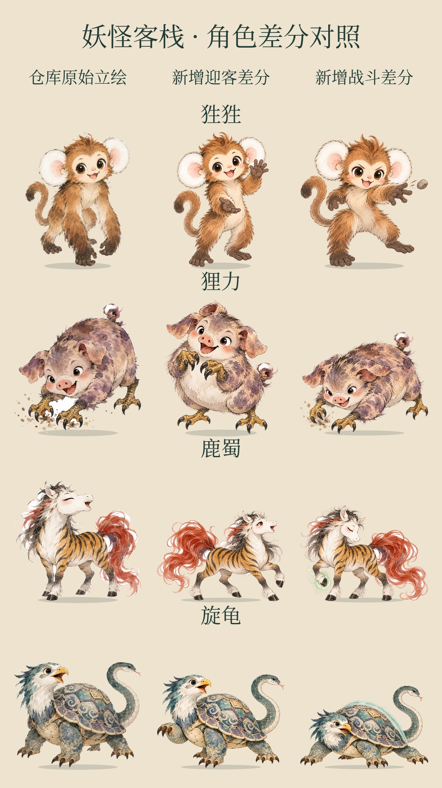
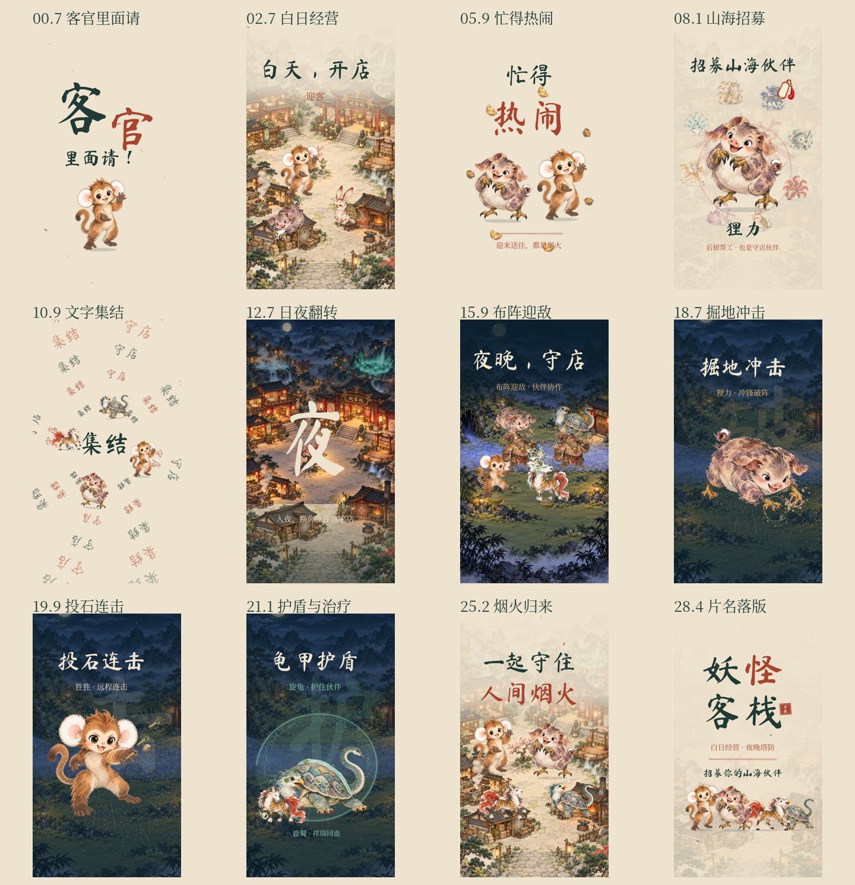

# 妖怪客栈 · 山海伙伴篇 V6

**30 秒竖版宣传演出 · 1080 × 1920 · 30fps**

- [下载 MP4 成片](./yaoguai-game-v6.mp4)
- [查看角色差分对照](./pose-comparison.jpg)
- [下载完整交付包](./yaoguai-game-v6-delivery.zip)：视频、离线 HTML、可编辑工程、原始素材、新增差分、音效、封面、分镜图与来源记录。
- [查看分镜总览](./storyboard.jpg)

视频或 ZIP 文件页请点击右上方 **Download raw file**。解压后用 Chrome / Edge 打开 `preview-standalone.html`，点击播放；全部资源已内嵌。

本版使用 `feature/kyl-import-game` 分支提交 `e9ae4ff` 的新美术：12 种水墨妖怪、3 类敌人、新昼夜与战场场景，以及食物、金币、设施、状态等 UI 素材。原始图片按字节保留，来源和校验值在交付包的 `provenance.json` 中。

为狌狌、狸力、鹿蜀、旋龟新增共 **8 个动作/表情差分**：迎客、开心、奔跑、投石、冲锋、治疗和防御，使用原角色图片作为生成参考。差分是本宣传片的新增衍生素材，尚非正式游戏动画资产。

文字也参与转场：“客”字放大开门、旋转集结字阵、“招→守”粒子转形、“日→夜”翻转、“破／击”随技能解体、“护”聚成护盾，收尾“守→客”呼应日常经营。

已检查 900 帧完整解码、浏览器 MP4 播放、手机布局、字体、播放/暂停/拖动/静音、离线 HTML、角色差分及关键转场。ZIP 完整性通过。

含原创合成音效，背景音乐待配。**采用游戏资源编排的宣传演出，非实机录屏。**

