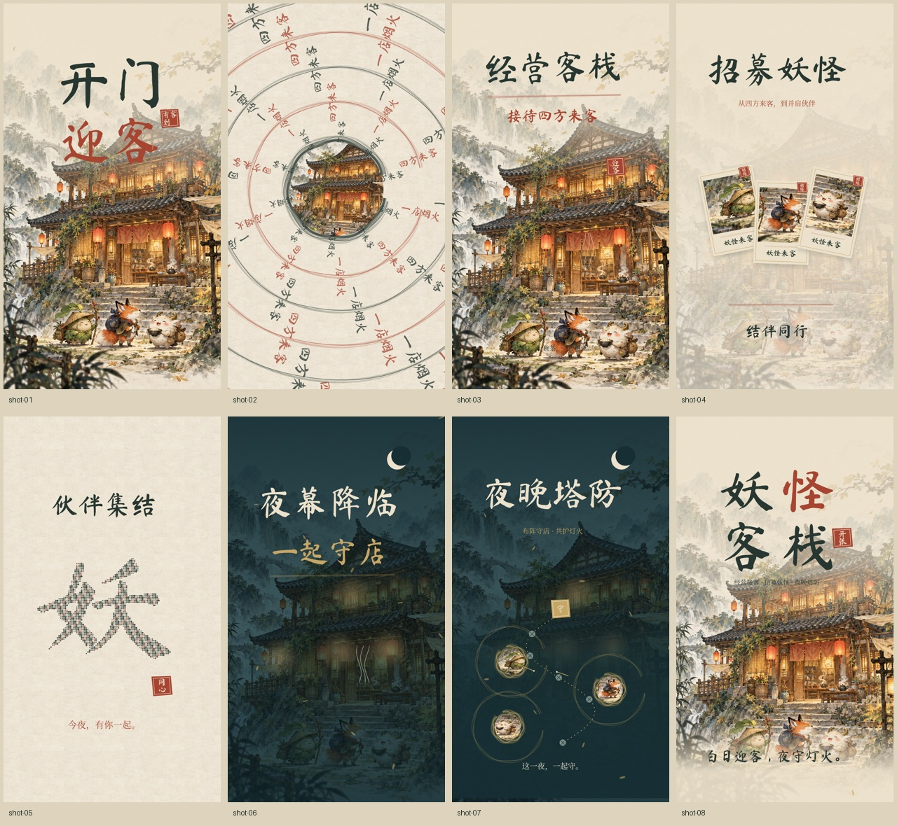

# 妖怪客栈 · 水墨玩法篇 V3

16 秒 / 1080 × 1920 / 30fps / **无声版本**。

保留 V2 的文字动效节奏，以水墨设色客栈、书法字、宣纸、朱砂印记和日夜灯火美化画面，加入用户确认的三项玩法：**客栈经营接客、招募妖怪、夜晚塔防**。

- [视频文件](./yaoguai-ink-v3.mp4)：打开后点击 **Download raw file** 下载播放。
- [完整交付包](./yaoguai-ink-v3-delivery.zip)：视频、HTML 播放器、源码、概念美术、字体授权与使用说明。

客栈、妖怪卡面和塔防布阵图为原创概念演绎，未使用正式角色原画或游戏实机截图。没有为概念角色设定官方姓名、职业或数值。参考录屏未包含在交付中。

已验证完整 480 帧解码、无音轨、字体与美术加载，以及 HTML 的播放、暂停、拖动、手机宽度布局。
