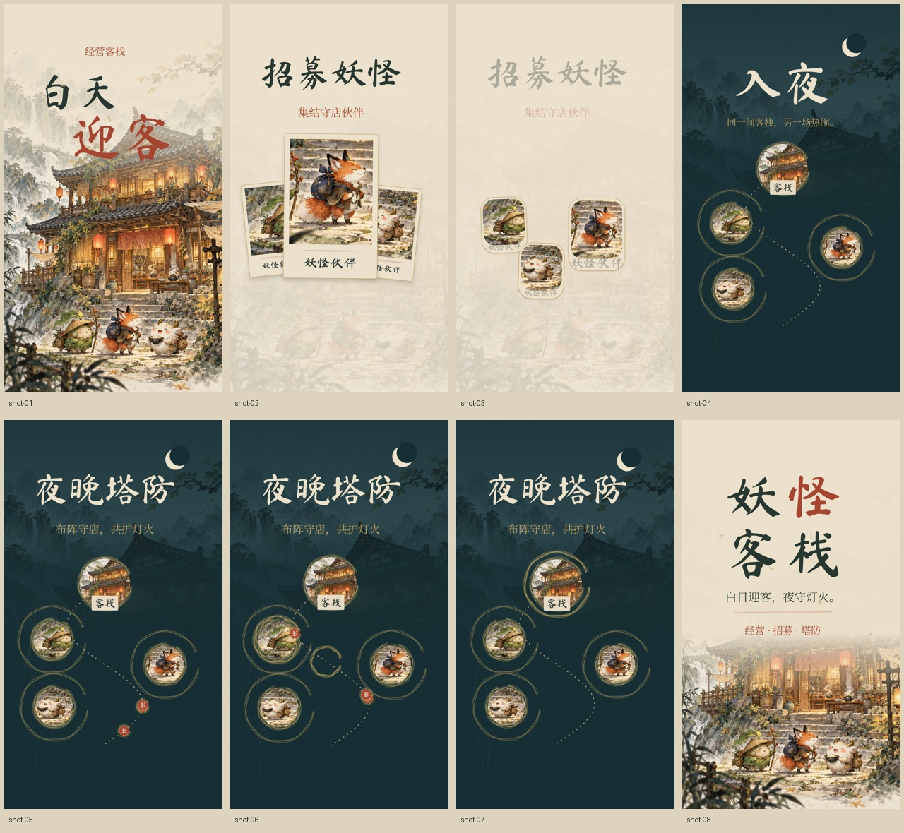

# 妖怪客栈 · 水墨叙事篇 V4

16 秒 / 1080 × 1920 / 30fps / **无声版**。

本轮集中优化节奏、布局和宣传叙事：经营迎客 → 招募伙伴 → 入夜 → 夜晚塔防 → 片名落版。

- [下载视频](./yaoguai-ink-v4.mp4)：点击文件页右上方 **Download raw file**。
- [完整交付包](./yaoguai-ink-v4-delivery.zip)：视频、HTML 播放器、可编辑工程、美术与字体授权、时间表及修改说明。

## 主要变化

- 开头合并重复内容；独立文字圈和聚字展示让位于玩法叙事。
- 招募角色放大，以一张主卡面建立清晰的视觉中心。
- 卡面衔接为同位置的夜晚布阵单位，关联招募与守店。
- 塔防段扩展到 5.2 秒，呈现来袭、出手、命中和守护收尾。
- 片名保持约 2.5 秒的稳定阅读时间，文字上移并强化背景反差。

本片仍为概念演绎，美术、卡面、塔防动线不代表游戏实机画面。尚未加入音乐，待用户提供音乐后配合剪辑。

已检查全部 480 帧解码、片长、无音轨、字体、美术、手机宽度布局和 HTML 播放/暂停/拖动。参考录屏未包含在交付包内。
