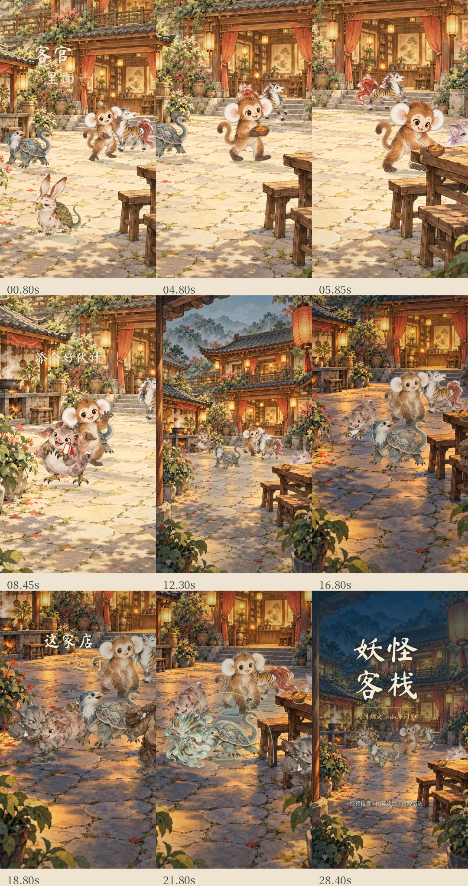

# 妖怪客栈 · 灯火同归篇 V7

30 秒竖版宣传演出 · 1080 × 1920 · 30fps。轻音效，背景音乐待配。

- [下载 MP4 成片](./yaoguai-world-v7.mp4)
- [下载完整工程与离线预览](./yaoguai-world-v7-delivery.zip)
- [查看分镜总览](./storyboard.jpg)
- [查看端汤／放碗细节](./service-detail.jpg)
- [音乐提示词与对点时间](./music-brief.md)

**视频或 ZIP 文件页请点击右上方 Download raw file。** 解压后用 Chrome / Edge 打开 `preview-standalone.html`，点击播放。图片、字体与音效全部内嵌；无需访问云环境地址。GitHub 不会直接运行 HTML。

本次围绕空间和动作重做：同一座近景院落贯穿迎客、端汤上菜、新伙计接手后厨、入夜协力守门。角色、影子、道具和背景共用镜头；前后景按深度缩放和遮挡，白天到夜晚沿用同一建筑布局。新增狌狌双手端汤、俯身放碗两种姿势，碗接触餐桌后留在桌上。减少独立角色展示和玩法字幕，让动作承接内容。

角色、敌人和道具来自游戏分支 `feature/kyl-import-game`，提交 `e9ae4ff31fdec9480a75635970e5aab77b2621b5`。12 张原始素材逐字节核对通过；新增院落、昼夜照明与角色差分为参考原素材生成的宣传衍生图。来源详见 `provenance.json`。

已检查 900 帧完整解码、MP4 浏览器播放、手机布局、播放／暂停／拖动／静音、断网 HTML 加载、镜头边界、字体和 ZIP 完整性。输出 H.264 / AAC，yuv420p、BT.709、48kHz 立体声。

工程包括 Canvas 时间线、Chromium／FFmpeg 导出器、原始素材与新增差分、字体许可、原创音效脚本、音乐对点、来源及验证记录。

**本片为二维分层宣传演出，包含姿势差分与程序形变，非实机录屏或完整逐帧手绘动画。**

